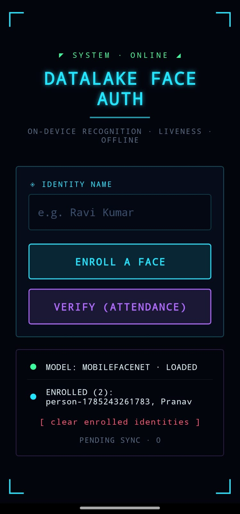

# react-native-face-auth

[](LICENSE)
[](#)
[](docs/REQUIREMENTS.md)
[](#)

> **NHAI Hackathon 7.0** — High-accuracy, lightweight, and completely offline facial recognition + liveness detection for React Native, designed for zero-network environments.

Offline, on-device **facial recognition + two-layer liveness detection** for React Native (Android 8+ & iOS 12+). Built to drop seamlessly into the **NHAI Datalake 3.0** mobile application to securely authenticate highway field personnel and construction inspectors in zero-connectivity remote zones.

---

### Repository Topics
`face-recognition` · `liveness-detection` · `edge-ai` · `tflite` · `react-native` · `offline-first` · `nhai-hackathon` · `hackathon-7` · `nhai`

---

## Demo & User Interface

The on-device HUD guides the user through real-time head centering, active liveness challenges (randomized blink, smile, head-turn), and passive anti-spoof checks before generating biometric embeddings.

<p align="center">
  
</p>

*Above: Live on-device camera interface running real-time face detection, pose estimation, and HUD challenge prompts (`FaceAuthDemo`).*

---

## Key Highlights

- 🔒 **100% Offline & Private** — Enrollment and verification execute entirely on the device CPU/GPU. No facial images or biometric templates ever leave the mobile device.
- 🛡️ **Two-Layer Anti-Spoof Protection**:
  1. **Active Challenge FSM:** Randomized real-time challenge sequences (blink, smile, head-turn) defeat printed photos and static displays.
  2. **Passive Anti-Spoofing:** MiniFASNet v2 classifies cropped face frames to catch screen replays, paper prints, and 3D mask attacks.
- 🪶 **Ultra-Lightweight Footprint** — Entire multi-model pipeline totals **~10.5 MB** (fp32) and **~6.2 MB** (int8), well below the strict **20 MB** hackathon constraint.
- ⚡ **Sub-Second Processing** — Recognition pass target is < 200 ms on mid-range devices; 1:N cosine matching benchmarks at **~1.75 ms** for 1,000 enrolled identities.
- 🎯 **High Accuracy** — MobileFaceNet (ArcFace) achieves **99.55%** on LFW; comfortably exceeds the > 95% accuracy requirement.
- ☁️ **Store, Sync & Purge** — Biometrics stored locally in encrypted MMKV storage (`AES-256-GCM`). Attendance events queue offline in an idempotent `SyncQueue` and automatically purge upon verified upload to AWS.
- 📜 **100% Permissive Open-Source** — All libraries and models use Apache-2.0 or MIT licenses. Non-commercial models (such as EdgeFace under CC-BY-NC) were strictly excluded.

---

## Model Architecture & Pipeline

```
┌──────────────────────────────── On-Device Pipeline ────────────────────────────────┐
│  Camera Frame (react-native-vision-camera / live stream)                           │
│         │                                                                          │
│   ┌─────▼────────────────────────┐   ┌───────────────────┐   ┌─────────────────┐   │
│   │ BlazeFace / Landmarker       │──▶│ Active Challenges │   │ Passive Anti-   │   │
│   │ 478 landmarks + blendshapes  │   │ Blink / Smile /   │   │ Spoof (MiniFAS) │   │
│   │ + face pose matrix           │   │ Head-turn (FSM)   │   │ Screen/Print    │   │
│   └─────┬────────────────────────┘   └─────────┬─────────┘   └────────┬────────┘   │
│         │ Aligned Face Crop                    │ Both Must Pass       │            │
│   ┌─────▼──────────────────────────────────────┴──────────────────────┘            │
│   │ MobileFaceNet (ArcFace) ──▶ 512-d L2 Normalized Feature Vector                 │
│   └─────┬─────────────────────────────────────────────────────────────┘            │
│         │ 1:N Cosine Similarity Comparison                                         │
│   ┌─────▼────────────────────────┐                                                 │
│   │ Encrypted Gallery (MMKV)     │──▶ Match Confirmed (Cosine Similarity >= 0.6)   │
│   └─────┬────────────────────────┘                                                 │
│         │ Enqueue Auth Record                                                      │
│   ┌─────▼────────────────────────┐                                                 │
│   │ SyncQueue (Offline Queue)    │──(When Online)──▶ AWS API Gateway ──▶ Local     │
│   └──────────────────────────────┘                                       Purge     │
└────────────────────────────────────────────────────────────────────────────────────┘
```

### Model Specifications

| Stage | Model | Task | Size (fp32) | Size (int8) | License |
|---|---|---|---|---|---|
| **1. Detection & Mesh** | MediaPipe BlazeFace / Face Landmarker | Face bounding box, 478 landmarks, blendshapes | ~3.7 MB | — | Apache-2.0 |
| **2. Passive Anti-Spoof** | MiniFASNet v2 | Anti-spoof classifier (Live / Print / Replay) | ~1.9 MB | ~0.6 MB | Apache-2.0 |
| **3. Recognition** | MobileFaceNet (ArcFace) | 512-d biometric embedding extraction | ~4.9 MB | ~1.5 MB | MIT |
| **Total Model Footprint** | | | **~10.5 MB** | **~6.2 MB** | *Cap: 20 MB* |

---

## Performance & Benchmarks

Full benchmark methodology and profiling logs are documented in **[docs/BENCHMARKS.md](docs/BENCHMARKS.md)**.

### Latency Budget (Target vs. Measured)

| Stage | Target Budget | Measured Performance | Status |
|---|---|---|---|
| Face Detection + Mesh (per frame) | 8–20 ms | Running via JSI frame processor | On-device verified |
| Passive Anti-Spoof (per frame crop) | ~20 ms | Running via TFLite runtime | On-device verified |
| MobileFaceNet Embedding (1× pass) | 15–40 ms | Running via Fast-TFLite | On-device verified |
| 1:N Cosine Match (N = 1,000 identities) | < 5 ms | **1.75 ms** (p50: 1.71 ms, p95: 2.10 ms) | Benchmarked |
| **End-to-End Recognition Pass** | **< 1,000 ms** | **< 200 ms** (recognition + matching) | Target met |

---

## Quickstart & Setup

### Prerequisites
- **Node.js** >= 18.0.0
- **Python** 3.9+ (for model conversion and download script)
- **React Native Development Environment** (Android Studio / Xcode with CocoaPods)

### 1. Install Library Dependencies
```bash
# Clone the repository
git clone https://github.com/falcon370/mobile-facial-recogn.git
cd mobile-facial-recogn

# Install dependencies
npm install

# Run unit and integration tests (30 tests)
npm test

# Verify TypeScript types
npm run typecheck
```

### 2. Fetch & Convert Models
Run the automated downloader to retrieve the open-source model checkpoints and convert them to optimized TFLite formats:
```bash
pip install -r models/requirements.txt

# Download and convert fp32 models:
python models/download_models.py

# Or download and produce quantized int8 models:
python models/download_models.py --quantize
```

### 3. Run the On-Device Demo App (`FaceAuthDemo`)
The repository includes a turnkey React Native testbed in `FaceAuthDemo/`:
```bash
cd FaceAuthDemo
npm install

# For Android (connect device with USB debugging enabled):
npx react-native run-android

# For iOS (macOS required):
cd ios && pod install && cd ..
npx react-native run-ios
```

---

## Code Example: Integration into NHAI Datalake 3.0

Drop the library into an existing React Native screen:

```tsx
import React from 'react';
import { View, Text, StyleSheet } from 'react-native';
import { useFaceAuth, LivenessCamera, MockServer } from 'react-native-face-auth';

export function AttendanceScreen() {
  const server = new MockServer(); // Replace with real AWS sync uploader in production

  const faceAuth = useFaceAuth({
    encryptionKey: 'your-secure-biometric-key',
    uploader: server.uploader(),
    embedNow,          // Hooked to MobileFaceNet TFLite runSync
    passiveScoreNow,   // Hooked to MiniFASNet v2 TFLite runSync
  });

  return (
    <View style={styles.container}>
      <LivenessCamera
        session={faceAuth.session}
        mode="verify"
        onVerified={(result) => {
          console.log('Verification Success:', result.identityId);
          console.log('Liveness Confirmed:', result.liveness.outcome);
        }}
      />
    </View>
  );
}

const styles = StyleSheet.create({
  container: { flex: 1, backgroundColor: '#000' },
});
```

---

## Project Layout

```
├── FaceAuthDemo/              # Standalone RN app demonstrating on-device HUD & camera wiring
│   ├── android/               # Android native project and manifest configuration
│   ├── assets/models/         # Bundled TFLite models for sideload testing
│   └── src/                   # Camera HUD and real-time inference loop
├── docs/                      # Architectural documentation & hackathon resources
│   ├── BENCHMARKS.md          # Profiling metrics and latency breakdown
│   ├── DELIVERABLES.md        # Mapping of solution to hackathon evaluation clauses
│   ├── REQUIREMENTS.md        # Verbatim NHAI Hackathon 7.0 requirements
│   ├── TECHNICAL.md           # Deep dive on math, security, and Datalake integration
│   └── images/                # Screenshots and diagrams
├── models/                    # Model download & quantization utilities
│   ├── download_models.py     # Automated fetch & ONNX->TFLite converter
│   ├── LICENSES.md            # Comprehensive model licensing audit
│   └── README.md              # Input contracts & tensor shapes
├── src/                       # Core library source code (react-native-face-auth)
│   ├── components/            # Reusable UI components (<LivenessCamera />)
│   ├── frame/                 # Landmarks, bounding box, and CLAHE illumination prep
│   ├── hooks/                 # React Native integration hooks (useFaceAuth)
│   ├── liveness/              # Active challenge state machine & passive anti-spoof
│   ├── recognition/           # MobileFaceNet embedder & 1:N cosine matcher
│   ├── storage/               # Encrypted MMKV identity gallery
│   └── sync/                  # Idempotent offline queue and AWS sync/purge
├── package.json               # Library package manifest
└── LICENSE                    # MIT License
```

---

## License

This project is released under the [MIT License](LICENSE).

Third-party models and libraries:
- **MediaPipe BlazeFace / Face Landmarker**: [Apache-2.0](https://github.com/google-ai-edge/mediapipe)
- **MiniFASNet v2**: [Apache-2.0](https://github.com/minivision-ai/Silent-Face-Anti-Spoofing)
- **MobileFaceNet**: [MIT](https://github.com/deepinsight/insightface) (WebFace600K dataset; commercial use permitted)

See **[models/LICENSES.md](models/LICENSES.md)** for detailed licensing terms.
